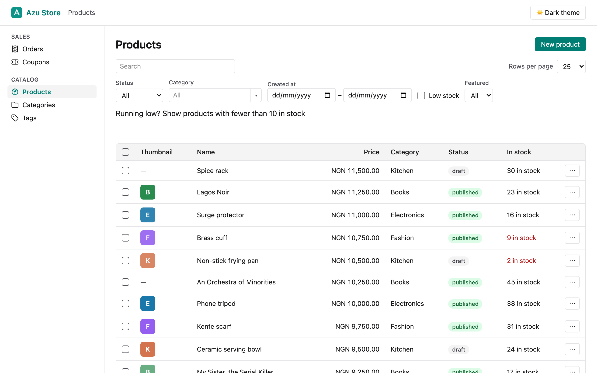
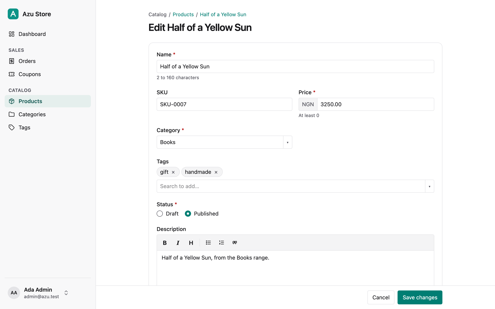

# Azu

**The back of your AdonisJS app.**

Azu is an admin panel for AdonisJS 7. It reads the models, policies, and validators you already wrote, then gives you a back office your team or client can use the same day.

*Azụ* is Igbo for "back". It's the part of your app your users never see, and the part your team lives in.

> [!NOTE]
> **Azu is pre-release.** This README describes the planned v1 API, and it will change based on feedback. If you'd use Azu on a real project in the next few months, [tell us about it](https://github.com/mezielabs/azu/discussions). Early testers get preview builds from week three.

<picture>
  <source media="(prefers-color-scheme: dark)" srcset="./docs/screenshots/list-dark.png">
  
</picture>

---

## Why Azu

Every client app eventually needs an admin. You can hand-build one, which means writing the same tables, forms, filters, and permission checks on every project. Or you can bolt on a generic tool that has its own config, its own permissions, and its own validation, which slowly drift away from your app's real rules.

Azu takes a different route. It doesn't add a second set of rules. It uses the ones you already have:

- **Lucid models** for data and relationships
- **Bouncer policies** for who can see and do what
- **VineJS validators** for form rules and error messages
- **Drive** for file and image uploads
- **Inertia and React** for the UI, so every page and field is a component you can replace

If your API rejects a request, Azu rejects it too. There's one source of truth, and it's your code.

## Requirements

- AdonisJS 7 with Lucid, Auth, and Bouncer
- Inertia with React
- Node.js 24.21 or later
- PostgreSQL, MySQL, or SQLite

## Installation

Azu's access gate is a Bouncer ability. The AdonisJS starter kits don't include Bouncer, so add it first if your app doesn't have it:

```sh
node ace add @adonisjs/bouncer
```

Then install and configure Azu with one command:

```sh
node ace add @mezielabs/azu
```

This registers the provider, creates `config/azu.ts`, mounts the panel at `/admin`, and adds a separate Vite entry so your public pages don't load any admin code.

It also adds an `accessAdmin` ability to `app/abilities/main.ts`. It returns `false` by default, so nothing is exposed until you decide who gets in:

```ts
// app/abilities/main.ts
import { Bouncer } from '@adonisjs/bouncer'
import type User from '#models/user'

export const accessAdmin = Bouncer.ability((user: User) => {
  return user.role === 'admin' || user.role === 'staff'
})
```

The starter kits' `User` model has no `role` column, and their signup page is public, so don't let every signed-in user in. While you try Azu on a fresh app, let yourself in by email, and narrow it before the app goes anywhere:

```ts
export const accessAdmin = Bouncer.ability((user: User) => {
  return user.email === 'you@example.com'
})
```

If you added Azu before Bouncer, run `node ace add @adonisjs/bouncer`, then `node ace configure @mezielabs/azu` to add the ability. Without Bouncer, Azu denies everyone.

Note: Azu uses your app's existing auth guard. Guests are redirected to your login page, and signed-in users who fail `accessAdmin` get a 403.

## Quick start

Generate a resource from an existing model (on a fresh starter kit, try `User`):

```sh
node ace azu:resource Product --policy
```

Azu reads the model's columns, casts, and relationships, then writes `app/admin/resources/product_resource.ts`, plus a create and update validator derived from the model's columns. The validator goes in `app/validators/product.ts`, or `product_admin.ts` if you already have that file; pass `--no-validator` to skip it. `--policy` writes `app/policies/product_policy.ts` if Product doesn't have a policy yet. It lets everyone who can open the admin panel list, view, create and update products, and it has no delete method; narrow it to your roles. Start your dev server and open `/admin`. You'll see a Products page with a list, search, and create, edit, and detail screens.

The generated resource is a starting point. Open it and adjust what's wrong.

## Resources

A resource is one file that points at a Lucid model and borrows its policy and validators:

```ts
// app/admin/resources/product_resource.ts
import { defineResource, column, field, filter } from '@mezielabs/azu'
import Product from '#models/product'
import ProductPolicy from '#policies/product_policy'
import { createProductValidator, updateProductValidator } from '#validators/product'

export default defineResource(Product, {
  label: 'Products',
  group: 'Catalog',
  icon: 'package',
  order: 1,
  title: 'name',
  search: ['name', 'sku'],
  policy: ProductPolicy,
  validators: { create: createProductValidator, update: updateProductValidator },
  query: (q) => q.preload('category'),

  columns: [
    column.image('thumbnail'),
    column.text('name').sortable(),
    column.decimal('price').format('currency', 'NGN').sortable(),
    column.belongsTo('category', 'name'),
    column.badge('status').colors({ draft: 'gray', published: 'green' }),
  ],

  fields: [
    field.text('name'),
    field.text('sku'),
    field.decimal('price').min(0),
    field.belongsTo('category').searchable('name'),
    field.manyToMany('tags').searchable('name'),
    field.select('status').options({ draft: 'Draft', published: 'Published' }),
    field.richText('description'),
    field.image('thumbnail').disk('s3').maxSize('2mb'),
  ],

  filters: [
    filter.select('status', { draft: 'Draft', published: 'Published' }),
    filter.belongsTo('category'),
    filter.dateRange('createdAt'),
    filter.custom('Low stock', (q) => q.where('stock', '<', 10)),
  ],
})
```

Resource definitions are typed against the model. A typo like `column.text('nmae')` fails `tsc`, not your client's demo.

The fields become the create and edit forms, checked by your validators. Saving goes to the record's page, or with "Create & add another" to a fresh form and with "Save & keep editing" back to the edit form:

<picture>
  <source media="(prefers-color-scheme: dark)" srcset="./docs/screenshots/form-dark.png">
  
</picture>

The list screen pages, sorts, searches and filters on the server, and keeps it all in the URL, so a reload, a bookmark or a shared link shows the same list. Relations shown in `belongsTo` columns are preloaded for you. Search uses `ILIKE '%term%'` on the `search` columns: on a large Postgres table, give those columns trigram indexes (`CREATE EXTENSION pg_trgm`, then `CREATE INDEX ... USING gin (name gin_trgm_ops)`), or every search scans the table.

Files in `app/admin/resources` load automatically and appear in the admin navigation, grouped by `group`, for users whose policy allows `viewList`. Prefer explicit registration? Turn off autoload in `config/azu.ts` and register resources in `start/azu.ts`:

```ts
// config/azu.ts
resources: { autoload: false },
```

```ts
// start/azu.ts
import azu from '@mezielabs/azu/services/main'
import productResource from '#admin/resources/product_resource'

azu.register(productResource)
```

### Navigation

The sidebar holds your brand, the dashboard and your resources, and at the bottom the signed-in user's account button. Its menu holds the theme (Light, Dark or System), "View site" (your `siteUrl`, `/` by default) and Sign out. Sign out posts to `/admin/logout`, which signs the user out of Azu's auth guard (`guard` in `config/azu.ts`) and sends them to your `loginUrl`. On screens narrower than 768px, a menu button in a top bar opens the sidebar as a drawer, with the same choices as full-width rows.

The navigation lists your resources, your [screens](#screens) and any links you add. Items without a `group` come first. Groups follow in the order you list in `config/azu.ts`, then any others alphabetically. Within a group, resources, screens and links sort together: `order` first (lower first), then items without one, alphabetically.

Links point anywhere: a filtered list, a page of your app, another site. A link to an absolute `http(s)` URL opens in a new tab, with an external-link icon. A link is highlighted when the page's path and query match it.

```ts
// config/azu.ts
navigation: {
  groups: ['Sales', 'Catalog'],
  links: [
    { label: 'Awaiting shipping', url: '/admin/resources/orders?status=paid', group: 'Sales', icon: 'truck', ability: viewOrders },
    { label: 'Help', url: 'https://docs.example.com' },
  ],
},
```

A link's `ability` (a Bouncer ability, like a screen's) only hides it from users who fail it. It doesn't protect the page it opens: that page must check access itself, as Azu's resource pages do through their policies.

`icon` is a [Lucide](https://lucide.dev/icons) icon name in kebab case, like `'package'` or `'shopping-cart'`. Install `lucide-react` to show icons; without it, the navigation shows none. The `azu()` Vite plugin bundles only the icons your resources, screens and links name, which it reads from `app/admin/resources`, `app/admin/screens` and `config/azu.ts`. If a resource sets `icon` in a way the plugin can't read, from a variable say, list the name in `azu({ icons: ['shopping-cart'] })`. An unknown name gives a warning at build time and shows no icon.

Labels come from names: `isFeatured` reads "Is featured", and common acronyms are capitals, so `sku` reads "SKU" and `userId` "User ID" (also URL, API, VAT and UUID). Give any field, column, filter or action its own with `.label('Featured')`.

### Field types

| Field | Form control | Notes |
| --- | --- | --- |
| `text`, `textarea` | Input, auto-growing textarea | |
| `number` | Numeric input | For numeric attributes (integers, floats). Supports `min`, `max`, `step` |
| `decimal` | Numeric input | For decimal columns, which Postgres and MySQL return as strings. The value stays an exact string end to end and is formatted with `Intl.NumberFormat`, never converted through `Number`. Supports `min`, `max`, `step`. When the list column of the same name has a currency format, the input shows its code as a prefix (`NGN`) |
| `boolean` | Toggle | |
| `select` | Dropdown, or radios for four or fewer options | |
| `date`, `datetime` | Date picker | Uses the admin timezone: `timezone` in `config/azu.ts`, or your server's timezone if you don't set it |
| `richText` | Rich text editor | Sanitised on the server before your validator sees it, and again before it's shown. The editor is Tiptap, loaded only when a form needs it; install `@tiptap/react`, `@tiptap/pm` and `@tiptap/starter-kit`, or you get a plain HTML textarea |
| `file`, `image` | Drag-and-drop upload | Stored with Drive on `disk()` or `defaultDisk`. Size (`maxSize()`, default 5mb for images, 10mb for files) and type (`accept()`) are checked on the server from the file's contents. SVG and HTML are refused unless you `accept()` them. Your validator sees the stored file's key |
| `belongsTo` | Searchable select | Loads options as you type |
| `hasMany` | Table on the detail page | Shows the related resource's columns, except the `belongsTo` back to this record (a category's products table has no Category column) |
| `manyToMany` | Searchable picker that adds and removes related records | Submits the related records' keys (`tags` → `tagIds`). Read-only for users who can't list the related resource, and on edit when attachments fall outside the related resource scope or exceed 200 |

You won't find `required()` on any field. Azu reads that from your VineJS validator, so the form and the rules can't disagree.

## Permissions

Azu checks your resource's Bouncer policy on every request. A missing method means denied.

```ts
// app/policies/product_policy.ts
import { BasePolicy } from '@adonisjs/bouncer'
import type User from '#models/user'
import type Product from '#models/product'

export default class ProductPolicy extends BasePolicy {
  viewList(user: User) {
    return user.role !== 'guest'
  }

  view(user: User, product: Product) {
    return true
  }

  create(user: User) {
    return user.role === 'admin'
  }

  update(user: User, product: Product) {
    return user.role === 'admin' || product.ownerId === user.id
  }

  delete(user: User) {
    return user.role === 'admin'
  }

  publish(user: User) {
    return user.role === 'admin'
  }
}
```

Buttons, fields, and actions a user can't use are hidden in the UI, but hiding is a convenience. The server always checks the policy, so a crafted request gets the same answer as a click.

## Validation

Create and update forms submit through the validators named on the resource. Azu only passes declared fields to the validator, so mass assignment stays limited to what you listed.

A resource with no validator for an operation can't save, by design: Azu never writes input that hasn't been through one of your validators.

A `belongsTo` field submits its foreign key (`category` → `categoryId`), so your validator checks `categoryId`.

A `manyToMany` field submits the related records' keys under the relation's singular name plus `Ids` (`tags` → `tagIds`), so your validator checks an array:

```ts
tagIds: vine.array(vine.number().exists({ table: 'tags', column: 'id' })).optional(),
```

Picker and filter values use Lucid's configured relation key: `localKey` for `belongsTo`, `relatedKey` for `manyToMany`. Detail links still use the related record's primary key.

Azu syncs the pivot rows with the validator's output, in the same transaction as the save, so a failure rolls back both. Leave `tagIds` out of a request and the attached records stay as they are; send an empty list to detach them all. This also works when the form uploads a file: Azu transports an empty selection as the string `[]` and restores the array before validation.

When a related resource's `query` scope hides attached records, the edit form makes that picker read-only and explains why. The server checks the scope again on submission and ignores changes to that field, preserving the entire attachment set. Its current keys still reach the validator.

The edit form loads up to 200 attached records. For a record with more, it shows the field read-only with a note ("350 tags attached; too many to edit here") and leaves `tagIds` out, so saving the form never detaches the ones it didn't load. The server applies the same rule, so `tagIds` sent anyway is ignored, and doesn't reach your validator either.

Validation errors show up under the field that caused them, including nested and array fields like `tags.0`.

They read as your validator words them. VineJS's defaults name a field by its key ("The price field must be at least 0"); to use the labels the form shows, give the validator a messages provider with them, keyed by input name (`categoryId`, not `category`):

```ts
import vine, { SimpleMessagesProvider } from '@vinejs/vine'

export const createProductValidator = vine.create({
  /* ... */
})

createProductValidator.messagesProvider = new SimpleMessagesProvider(
  {
    'required': '{{ field }} is required',
    'min': '{{ field }} must be at least {{ min }}',
    'database.unique': '{{ field }} is already taken',
  },
  { price: 'Price', sku: 'SKU', categoryId: 'Category' }
)
```

A failed `min` rule on `price` then reads "Price must be at least 0". The demo's `app/validators/messages.ts` has a fuller set, a helper that applies them, and a `minDecimal` rule for decimals kept as strings, so "-5" fails its bound rather than its format.

Note: validators written for your API don't always fit a form. If update needs different rules from create (an optional password, say), give the resource a separate `update` validator.

Some validators need context, such as an update validator whose `unique` rule has to skip the record being edited. Azu passes `{ record }` as VineJS metadata: the record being edited on update, `undefined` on create. If your validator expects a different shape, map it with `meta`, which receives the record and the HTTP context:

```ts
validators: {
  create: createProductValidator,
  update: updateProductValidator,
  meta: ({ record }) => ({ productId: record?.id }),
},
```

## Filters

Each filter is a URL query parameter named after it, so a filtered view can be bookmarked: `?status=published&category=3&createdAt=2026-10-01..2026-10-31&low-stock=1`. Filters combine with each other, with search and with sort, and changing one goes back to page 1.

- `filter.select(column, options)` and `filter.boolean(column)` match a column.
- `filter.dateRange(column)` takes whole days in the admin's timezone (`timezone` in `config/azu.ts`). Either end can be left open.
- `filter.belongsTo(relation)` picks a related record from a searchable list. It shows only to users who pass the related resource's `viewList`, like a `belongsTo` field.
- `filter.custom(label, query)` is an on/off filter with your own query, typed against the model. Its parameter is the label in kebab case (`low-stock`).

A filter can't be named after the list's own parameters (`page`, `perPage`, `sort`, `direction`, `search`), and values that don't fit a filter are ignored rather than failing the page.

## Actions

Actions are async functions. They run on a single row (from the list's row menu or the detail page), or on a selection of rows as a bulk action:

```ts
actions: [
  action.bulk('publish')
    .confirm('Publish the selected products?')
    .ability('publish')
    .handle(async (products, { trx }) => {
      await Product.query({ client: trx })
        .whereIn('id', products.map((p) => p.id))
        .update({ status: 'published' })

      return { message: `${products.length} products published` }
    }),

  action.row('restock')
    .ability('restock')
    .fields([field.number('quantity')], restockValidator)
    .handle(async (product, { input }) => {
      product.stock += input.quantity
      await product.save()
      return { message: `${product.name} now has ${product.stock} in stock` }
    }),
]
```

`.ability('publish')` checks the `publish` method on your policy for each record; without `.ability()`, an action checks `update`. In a bulk action, records the user can't touch are skipped and reported, rather than failing the whole batch.

Once every row on the page is selected, the bulk toolbar offers **Select all N matching**. The action then runs on every row the list's search and filters match, up to 10,000:

- **In chunks:** 500 records at a time, each chunk in its own transaction, with the same policy check per record. Your handler is called once per chunk, so it shouldn't assume it sees every record at once.
- **Partial success:** if a chunk fails, it rolls back and the run stops, but the chunks before it stay done. The confirm dialog says so before a run of more than 500, and the toast reports how many were done, skipped and not changed. Azu writes that toast, so a handler's `{ message }` isn't shown, and `{ redirect }` applies only when the whole run succeeds.
- **Running it again:** finished chunks stay done, so running the action again repeats it on those rows. Write handlers that are safe to run twice, or filter so done rows drop out (filter by status: draft before publishing, say).
- **Which rows:** the ones that matched when the run started. Rows added meanwhile are left out, and a row that no longer matches when its chunk runs is skipped. If more rows match than the count the user confirmed, nothing runs.
- **The limit:** with more than 10,000 matching rows, the action is refused before anything changes. Narrow the filters and run it on each part.

The handler runs in a transaction, with its records bound to it. Run your other queries through `trx` too, so that if the handler throws, all its changes roll back and the user sees an error toast. An AdonisJS `Exception` with a status below 500 shows its message; any other error shows a generic message and goes to your log.

`.fields()` asks for input in the action's dialog. The input goes through the validator you pass, like a form's, and the handler gets the validator's output as `input`. `.destructive()` styles the action like Delete. Return `{ message }` for a toast, or `{ redirect }` to go somewhere else.

To share an action between resources, generate it with `node ace azu:action Archive`, import it from `#admin/actions/archive` and add it to each resource's `actions`. Every resource that uses it needs the ability on its policy; `tsc` checks.

When the policy has a `delete` method, every resource gets a Delete row and bulk action, with a confirmation. It runs `beforeDelete` for each record, and deletes their stored files after the transaction commits.

## Screens

A screen is a page of your own in the panel: a report, a summary, a tool. It has its own ability, your component, and data from the server, or a [form](#form-screens) or [widgets](#widgets) Azu renders. Generate one:

```sh
node ace azu:screen SalesReport
```

That writes `app/admin/screens/sales_report.ts` and its component, `inertia/admin/components/sales_report.tsx`. Both compile and render as they are. The screen opens at `/admin/screens/sales-report`, named after its file:

```ts
// app/admin/screens/sales_report.ts
import { defineScreen } from '@mezielabs/azu'
import { viewReports } from '#abilities/main'

export default defineScreen({
  label: 'Sales report',
  group: 'Reports',
  icon: 'chart-column',
  ability: viewReports,
  component: 'SalesReport',
  data: async (ctx) => ({ rows: await totalsByDay(ctx.request.qs().days) }),
})
```

- **`ability`** is required: a Bouncer ability object from `app/abilities/main.ts`, not a string. Azu checks it on every request, inside the panel's access gate. A user who fails it, or an ability that throws, gets a 403, and doesn't see the screen in the navigation.
- **`data`** runs on the server for each request, after the ability check. Return plain, JSON-serialisable values. It's a lazy Inertia prop, so a partial reload of `data` (`router.reload({ only: ['data'] })`) computes only that.
- **`component`** names a component in `inertia/admin/components`, as fields and slots do. It gets `{ data, screen }`, typed from the screen:

```tsx
// inertia/admin/components/sales_report.tsx
import type { ScreenProps } from '@mezielabs/azu-react'
import type salesReport from '#admin/screens/sales_report'

export default function SalesReport({ data }: ScreenProps<typeof salesReport>) {
  return <p>{data.rows.length} days</p>
}
```

Screens in `app/admin/screens` load at boot (`screens.autoload` in `config/azu.ts`, like resources). Two with the same name stop the app from booting. With autoload off, register them in `start/azu.ts`: `azu.registerScreen('sales-report', salesReport)`.

### Form screens

A screen can have a form instead of a component: settings, a profile, anything that isn't one record of a model. Azu renders it like a resource form and saves through your validator. Where the values live is up to you: `load` reads them and `save` writes them.

```sh
node ace azu:screen StoreSettings --form
```

That writes the screen and a validator in `app/validators/store_settings.ts`. Fill in `load` and `save`:

```ts
// app/admin/screens/store_settings.ts
import { defineScreen, field } from '@mezielabs/azu'
import { DateTime } from 'luxon'
import { manageSettings } from '#abilities/main'
import Setting from '#models/setting'
import { storeSettingsValidator } from '#validators/store_settings'

export default defineScreen({
  label: 'Store settings',
  group: 'Settings',
  icon: 'settings',
  ability: manageSettings,
  form: {
    fields: [
      field.text('storeName'),
      field.select('currency').options({ NGN: 'Nigerian naira', GHS: 'Ghanaian cedi' }),
      field.decimal('vatRate').label('VAT rate (%)'),
      field.boolean('maintenanceMode'),
      field.richText('checkoutAnnouncement'),
      field.datetime('lastChangedAt').label('Last changed').readOnly(),
    ],
    validator: storeSettingsValidator,
    // Your storage: here, the demo's key/value settings table
    load: () =>
      Setting.values([
        'storeName',
        'currency',
        'vatRate',
        'maintenanceMode',
        'checkoutAnnouncement',
        'lastChangedAt',
      ]),
    save: (input) => Setting.store({ ...input, lastChangedAt: DateTime.now() }),
  },
})
```

- **`form` or `component`, not both**, and no `data` beside a form: its values come from `load`. Either mistake is a type error and stops the app from booting.
- **Field names are checked against what `load` returns**, so a misspelled field fails `tsc`, as on resources. Screen forms take text, textarea, number, decimal, boolean, select, date, datetime and rich text fields. File, image and relation fields aren't supported on screens yet.
- **The screen's `ability` covers the form**, for opening it and for saving it, so fields have no `.ability()` here. `.readOnly()` works as on resources.
- **Saving works like a resource form.** Only the form's writable fields are read from the request, then checked by the validator. Read-only fields reach the validator with `load`'s values. `save` gets the validator's output and nothing else. Rich text is sanitised and datetimes are read in the panel's `timezone`. A valid save comes back to the screen with a toast ("Store settings saved", or `successMessage`). Invalid input shows the errors under each field, with the input kept.
- **The page** is the resource form's layout: the same widths, required markers and limits from the validator, the sticky save bar with a single "Save changes" button, and the "Leave without saving?" question.

### The home screen

By default `/admin` is a welcome page. Set `home` to show a screen there instead, with the URL unchanged, or to go to a resource's list:

```ts
// config/azu.ts
home: 'overview',
// or
home: { resource: 'orders' },
```

The home screen replaces "Dashboard" at the top of the navigation. A user who fails its ability gets the welcome page, not a 403. With `{ resource }`, only users who may list that resource are redirected; everyone else gets the welcome page. A `home` that names no screen or resource stops the app from booting.

## Widgets

A screen can show widgets instead of a component or a form: key figures, a goal, a breakdown, a few recent records. Each widget reads one of your resources, through its own `query` hook, and shows only to users who may list that resource.

```ts
// app/admin/screens/overview.ts
import { defineScreen, metric } from '@mezielabs/azu'
import { accessAdmin } from '#abilities/main'
import orders from '#admin/resources/order_resource'

export default defineScreen({
  label: 'Overview',
  ability: accessAdmin,
  ranges: ['today', '7d', '30d', 'month'], // the first is the default
  widgets: [
    metric
      .value('Revenue')
      .sum(orders, 'total')
      .where((q) => q.whereIn('status', ['paid', 'shipped', 'delivered']))
      .date('placedAt')
      .format('currency', 'NGN')
      .link({ status: 'paid' }),
    metric.value('Orders').count(orders).date('placedAt'),
    metric
      .progress('October revenue goal')
      .sum(orders, 'total')
      .date('placedAt')
      .period('month')
      .goal(6_000_000),
    metric.partition('Orders by status').count(orders).groupBy('status').date('placedAt'),
    metric.table('Recent orders').resource(orders).latest('placedAt').limit(5),
  ],
})
```

- **Kinds:** `metric.value()` is one figure, `metric.progress()` a figure against a goal, `metric.partition()` a figure per value of a column, as bars, and `metric.table()` a few records with the resource's columns. A screen has `widgets`, `component` or `form`, never two of them.
- **Aggregates:** `count(resource)`, and `sum`, `avg`, `min` and `max(resource, column)`. Column names are typed against the resource's model, so a misspelled column fails `tsc`. `sum` and the others take number columns and the columns the resource lists with `column.decimal()`: decimals are typed `string` on the model, so the resource is what says a column holds numbers. Decimal results stay exact strings on every database, and `avg` rounds to the column's scale (2 places for a number column).
- **Access and scoping:** a widget needs the resource's `viewList`. Without it, the widget isn't on the page at all. Every widget's query starts from the resource's `query` hook, then the widget's `where()`, then the range, so a user never sees totals for records they couldn't list.
- **Ranges:** `today`, `7d`, `30d`, `90d`, `month` (to date), `quarter` (to date) and `year` (to date), in the panel's `timezone`. The range is in the URL as `?range=`, and the switch beside the title changes it. A value widget with a `date()` is compared with the period before: the same number of days before for `7d`, `30d` and `90d`, and as long again from the start of the previous month, quarter or year for the to-date ranges. It reads "▲ 12.4% from NGN 4,281,750.00", "New" when the period before was 0, or "No change". `.compare(false)` turns it off. For figures where down is good (cancellations, refunds, response times), `.lowerIsBetter()` colours a decrease as the good change and an increase as the bad one; the arrow still shows the real direction, and the words say "better" or "worse". A widget without a `date()` is all-time, ignores the range, and says so.
- **Progress** has its own `period()` (`day`, `week`, `month`, `quarter` or `year`, to date), not the screen's range. It shows how much of the goal is reached and how far through the period you are. `goal()` takes a number or `(ctx) => number`.
- **Partition** labels come from the resource's select field or badge column, else the value in sentence case. Rows go largest first, and equal ones keep the options' order, then the labels'. `.limit(n)` (default 5) folds the rest into "Other".
- **Tables** use the resource's columns (or `.columns([...])`, a typed subset) and its preloads, and link each row to its record when the user may `view` it. A table wider than its card scrolls sideways inside it, like the list. `.latest(column)` or `.orderBy(column, direction)` order them, and `.limit(n)` (default 5) caps them.
- **Links:** `.link(filters?)` on a value or table widget links it to the resource's list, filtered by the resource's own filters, and by the range when the resource has a `dateRange` filter on the `date()` column. Partition rows link to the list filtered by their value when the resource has a select filter on that column. Filter names are checked at boot. Keep a widget's `link()` filters matching its `where()`: Azu can't translate a query into list filters, so a link can only narrow the list the ways its filters can.
- **Your own figure:** `metric.value(label).using(async (ctx, range) => number)` computes a value yourself. With no resource there's no automatic access check or scoping, so it needs `.ability(ability)`. It's called again with the previous period's range for the comparison.
- **Width:** values, progress and partitions take one of the grid's four columns and tables two; `.width(1 | 2 | 3 | 4)` changes it. The grid is two columns on narrower screens, and one on phones.
- **Loading:** each widget loads on its own after the page appears, so a slow or failing widget never holds up the others. A widget that throws shows "Couldn't load this" in its card, with a Try again button that reloads that widget alone, and the error goes to your log with the screen's and widget's names.
- **Indexes:** each widget queries its resource's table with the range on the `date()` column, so index that column, and a table widget's sort column. On 100,000 orders on Postgres, the demo's Overview widgets take under 20 ms each at p95 with an index on `placed_at`, and up to 35 ms without one.

## Customising

Azu gives you three levels of control. Start with the smallest one that works.

**1. Config.** Labels, icons, groups, page size, and branding live in the resource or in `config/azu.ts`. No React needed.

**2. Swap a component.** Point any field or column at your own React component:

```ts
field.text('sku').component('SkuInput'),
column.custom('stock', 'StockBar'),
```

```tsx
// inertia/admin/components/sku_input.tsx
import type { FieldProps } from '@mezielabs/azu-react'

export default function SkuInput({ field, value, onChange, errors }: FieldProps<string>) {
  return (
    <label className="azu-field">
      <span className="azu-label">{field.label}</span>
      <input
        className="azu-input"
        value={value ?? ''}
        onChange={(e) => onChange(e.target.value.toUpperCase())}
        aria-invalid={errors.length > 0}
      />
      {errors.length > 0 && <span className="azu-field-error">{errors.join(' ')}</span>}
    </label>
  )
}
```

```tsx
// inertia/admin/components/stock_bar.tsx
import type { CellProps } from '@mezielabs/azu-react'

export default function StockBar({ value }: CellProps<number>) {
  const stock = value ?? 0
  return (
    <span style={{ color: stock < 10 ? 'var(--azu-danger)' : undefined }}>{stock} in stock</span>
  )
}
```

Components in `inertia/admin/components` are registered by file name, so `sku_input.tsx` becomes `SkuInput`. Each one loads only when a page that uses it opens, so they add nothing to the admin's initial JavaScript. A field component gets `FieldProps`: the `value`, `onChange`, the field's `errors`, the `field` itself and the form's other values as `record`. A cell gets `CellProps`: its `value`, the row as `record`, and the `column`. `.component()` works on every column kind, and `column.custom()` is a column with no formatting of its own.

**Slots.** To add something to a page without replacing it, name a component for one of a resource's slots. A Print button for an order:

```ts
// app/admin/resources/order_resource.ts
export default defineResource(Order, {
  // ...
  slots: { toolbar: 'PrintOrder' },
})
```

```tsx
// inertia/admin/components/print_order.tsx
import type { SlotProps } from '@mezielabs/azu-react'

export default function PrintOrder({ page }: SlotProps) {
  // The toolbar slot is on every Orders page; printing is for one order
  if (page !== 'show') return null

  return (
    <button type="button" className="azu-button" onClick={() => window.print()}>
      Print
    </button>
  )
}
```

Azu's stylesheet leaves the sidebar, the top bar and the page's actions out of print, so the page prints just the order.

The slots are `header` (under the page title, on every page of the resource), `toolbar` (beside the page's own buttons), `beforeTable` (above the list) and `afterForm` (under the create and edit forms). A slot component gets `SlotProps`: the `resource`, the `page` (`index`, `create`, `edit` or `show`), the `record` on the edit and detail pages, and the resource's list URL as `path`.

**3. Publish a page.** Copy any page into your app and edit it however you like:

```sh
node ace azu:publish resource/index
```

This copies the page to `inertia/admin/pages/resource/index.tsx`, with a comment at the top recording the Azu version it came from. Page names are snake_case paths, like your app's own Inertia pages; the older `Resource/Index` spelling works too. Run `node ace azu:publish` without a page to list them. It won't replace a page you've already published unless you pass `--force`.

Azu renders your copy from then on. It's the most flexible option, but you now own that page through upgrades. Run `node ace azu:doctor` after upgrading to see which published files drifted from the new version.

## Theming

Set your brand once and Azu generates light and dark palettes from it:

```ts
// config/azu.ts
import { defineConfig } from '@mezielabs/azu'

export default defineConfig({
  path: '/admin',
  guard: 'web',
  loginUrl: '/login',
  // The account menu's "View site" link; false hides it
  siteUrl: '/',
  brand: { name: 'Acme', logo: '/images/logo.svg', color: '#2563eb' },
  perPage: 25,
  defaultDisk: 's3',
  // Dates are entered and shown in this timezone. Defaults to the server's (TZ)
  timezone: 'Africa/Lagos',
})
```

`brand.name` (default `Admin`) shows at the top of the sidebar and in page titles, and `brand.logo` is an image shown before it (without one, a tile with the name's first letter). `brand.color` is a hex colour (default `#2563eb`). Azu uses it as is where it's readable. Where it isn't, it shifts only the colour's lightness, so the hue stays, until all text reaches WCAG AA (4.5:1) on each theme's backgrounds. A very light brand colour gets darkened on the light theme, for example. So the exact hex on screen may differ from `brand.color`, and from light mode to dark mode. Text on brand-coloured buttons is white or near-black, whichever reads.

Dark mode follows the user's system setting (System, the default). Light or Dark in the account menu overrides it, and this browser remembers the choice; System forgets it and follows the system again, live.

The palettes are Azu's own CSS variables (`--azu-brand`, `--azu-surface`, `--azu-text` and so on), set on `<html>`.

## Commands

| Command | What it does |
| --- | --- |
| `node ace add @mezielabs/azu` | Installs and configures Azu |
| `node ace azu:resource <Model>` | Generates a resource from a model, plus a create and update validator in `app/validators` unless you pass `--no-validator`. Add `--policy` to create a policy when the model has none, or `--readonly` for list and detail only |
| `node ace azu:action <Name>` | Creates a reusable row action in `app/admin/actions`, or a bulk one with `--bulk`, with an ability, a confirmation and a handler that uses the action's transaction |
| `node ace azu:screen <Name>` | Creates a [screen](#screens) in `app/admin/screens` and its component in `inertia/admin/components`, ready to open at `/admin/screens/<name>`. With `--form`, a [form screen](#form-screens) and its validator in `app/validators` instead |
| `node ace azu:publish [page]` | Copies one of Azu's pages into `inertia/admin/pages` for editing, stamped with the version it came from. Without a page, lists them |
| `node ace azu:doctor` | Checks config (including a `home` that names nothing), missing policy methods, validators that miss form fields (screen forms' too), component names with no file (screens' too), widgets that can't work (a `link()` filter or `date()` column the resource doesn't have, or a resource without `viewList`), and published pages that drifted. Exits with 1 on an error |

## Azu Pro

The core is free and MIT licensed, and it always will be. Azu Pro adds the extensions clients tend to ask for once the basics work:

- **Audit log** of every admin change, with before and after values
- **CSV import and export** with a validation preview before anything is saved
- **Impersonation** so support staff can see exactly what a user sees
- **Multi-tenancy** with automatic query scoping
- **Premium layouts and theme**

Pro is licensed per project or for unlimited projects, and is checked at install, never at runtime. A lapsed licence never takes down a production admin.

## Roadmap

- [ ] v0.x previews for early testers
- [ ] v1.0: resources, fields, relationships, permissions, validation, actions, filters, theming
- [ ] v1.1: bulk actions on all filtered rows, navigation badges, more override slots
- [ ] Azu Pro
- [ ] Vue support, if there's demand

## Contributing

Azu is early, so the most useful contribution right now is feedback on this API. Open a [discussion](https://github.com/mezielabs/azu/discussions) with what you'd change, or what your current admin does that this wouldn't.

## License

MIT. Built by [Mezie Labs](https://mezielabs.com).
