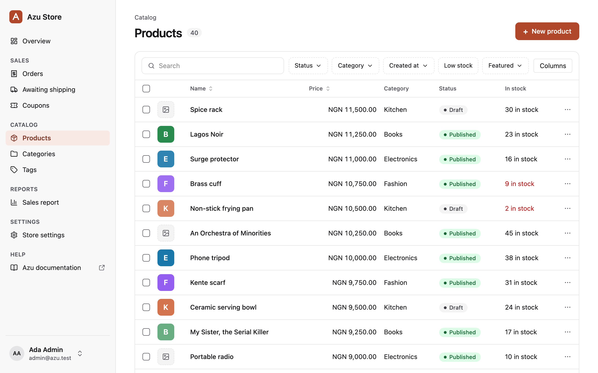
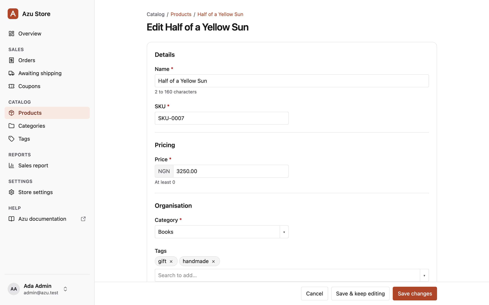

# Azu

**The back of your AdonisJS app.**

Azu is an admin panel for AdonisJS 7. Build searchable lists, detail pages, and forms using your existing Lucid models, Bouncer policies, and VineJS validators.

> [!NOTE]
> **Azu is in preview (0.1.0-preview.0).** The API may change based on feedback; tell us in [Discussions](https://github.com/mezielabs/azu/discussions).

**Documentation: [azuadmin.com/docs](https://azuadmin.com/docs)**

<picture>
  <source media="(prefers-color-scheme: dark)" srcset="./docs/screenshots/list-dark.png">
  
</picture>

## Requirements

- AdonisJS 7 with Lucid, Auth, and Bouncer
- Inertia with React (the React and Vue starter kits work; see [Starter kits](https://azuadmin.com/docs/starter-kits/))
- Node.js 24.21 or later
- PostgreSQL, MySQL, or SQLite

## Install

Add Bouncer if your app doesn't have it, then install Azu with the `preview` tag and configure it:

```sh
node ace add @adonisjs/bouncer
npm i @mezielabs/azu@preview @mezielabs/azu-react@preview
node ace configure @mezielabs/azu
```

Configuring adds an `accessAdmin` ability to `app/abilities/main.ts` that lets no one in. Update it to allow your account. On a fresh starter kit, generate a resource for `User`:

```sh
node ace migration:run
node ace azu:resource User --policy
npm run dev
```

Sign in with the account you allowed, then open `/admin`. The [installation guide](https://azuadmin.com/docs/installation/) and [quick start](https://azuadmin.com/docs/quick-start/) have the details.

## A resource

One file points at a Lucid model and borrows its policy and validators. This is the demo store's categories:

```ts
// app/admin/resources/category_resource.ts
import { column, defineResource, field } from '@mezielabs/azu'
import Category from '#models/category'
import CategoryPolicy from '#policies/category_policy'
import { createCategoryValidator, updateCategoryValidator } from '#validators/category'

export default defineResource(Category, {
  group: 'Catalog',
  icon: 'folder',
  order: 2,
  title: 'name',
  search: ['name', 'slug'],
  policy: CategoryPolicy,
  validators: { create: createCategoryValidator, update: updateCategoryValidator },

  columns: [column.text('name').sortable(), column.text('slug')],
  fields: [
    field.text('name'),
    field.text('slug'),
    field.textarea('description'),
    field.hasMany('products'),
  ],
})
```

It's typed against the model, so a typo like `column.text('nmae')` fails `tsc`. The fields become the create and edit forms, checked by your validators:

<picture>
  <source media="(prefers-color-scheme: dark)" srcset="./docs/screenshots/form-dark.png">
  
</picture>

## Contributing

Azu is early, so the most useful contribution right now is feedback on the API. Open a [discussion](https://github.com/mezielabs/azu/discussions) with what you'd change, or what your current admin does that this wouldn't.

The repository is a pnpm workspace: `packages/core` (`@mezielabs/azu`), `packages/react` (`@mezielabs/azu-react`), `apps/demo` (the demo store), and `apps/docs` (the documentation site; its voice is in [apps/docs/STYLE.md](apps/docs/STYLE.md)).

## License

MIT. Built by [Mezie Labs](https://mezielabs.com).
